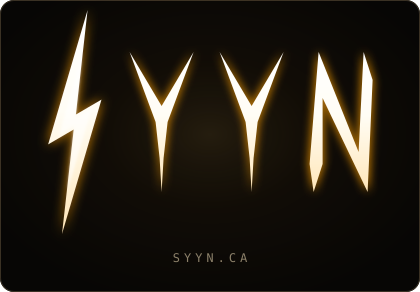

## `sYYn`

Threat intelligence, malware reverse engineering, defensive architecture.

Criminal operations are run by people. Most of my work is understanding how those
people are organized — the aliases, the infrastructure, the operational habits —
and building things that hold up against them.

---

**Currently**

- A graph engine for mapping actor aliases, relationships, and infrastructure. NocTORnal pinned below.
- Detection tooling and GRC automation. Public — see repositories.
- Write-ups. Some of them published.

**Working knowledge**

Static and dynamic binary analysis · YARA · adversary emulation · detection
engineering · AWS security architecture · incident response

CySA+ · CASP+ · GREM · blah blah, some others too, but this book study stuff doesn't really matter.

---

Struggling with AI? Learn about AI here; All .html with no dependencies. 
https://dboudreau.dev/latent-space.html

---

  

